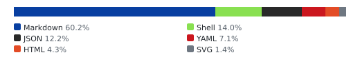
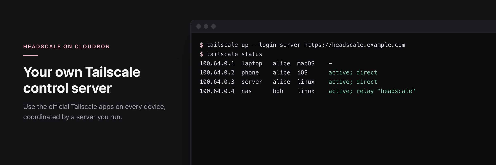
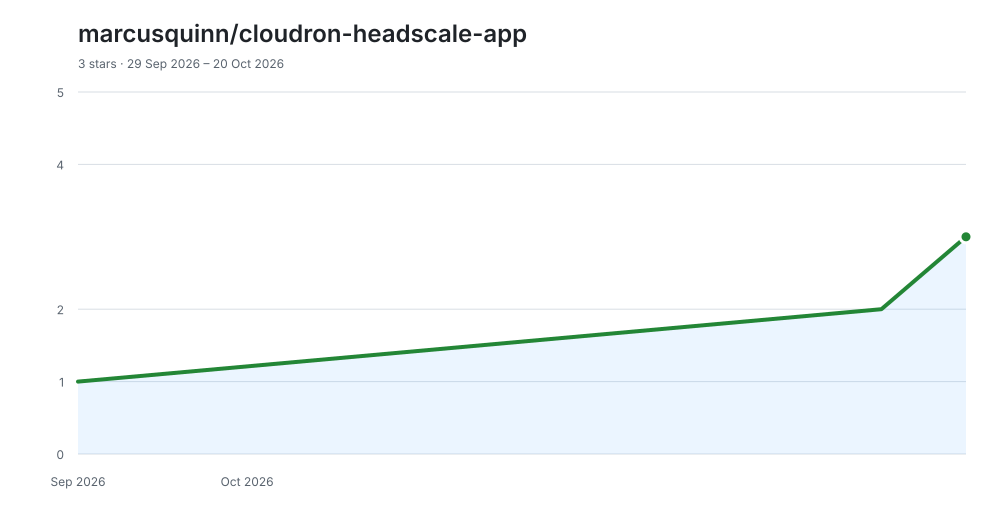

# cloudron-headscale-app

<!-- aidevops:badges:start -->
<!-- managed by aidevops badges; edit the template, not this block -->
[](https://github.com/marcusquinn/cloudron-headscale-app/blob/main/LICENSE)
[](https://github.com/marcusquinn/cloudron-headscale-app/releases/latest)

[](docs/metrics/repo-metrics.md)
[](docs/metrics/repo-metrics.md)

[](docs/metrics/repo-metrics.md)
<!-- aidevops:badges:end -->
[Headscale](https://github.com/juanfont/headscale), the self-hosted Tailscale
control server, packaged for [Cloudron](https://www.cloudron.io). Devices run
the official Tailscale apps and join a private WireGuard mesh coordinated by
your Cloudron.



## Install

In Cloudron, open *Settings → Community apps*, add this catalog URL, then
install Headscale from the App Store:

```text
https://raw.githubusercontent.com/marcusquinn/cloudron-headscale-app/main/CloudronVersions.json
```

Or with the CLI:
`cloudron install --versions-url <catalog URL> --location headscale.example.com`.

Leave **Sign in with Cloudron** on unless you only want pre-auth keys. Keep the
**STUN** UDP port (default 3480) enabled; if your server sits behind a provider
firewall, allow that UDP port there too.

## Add devices

**With Cloudron sign-in.** On Linux:

```sh
tailscale up --login-server https://headscale.example.com
```

Open the printed link, sign in with Cloudron, and the device joins. On macOS,
iOS and Windows, use the Tailscale app's alternate coordination server option;
your server's `/apple` and `/windows` pages show the steps. Anyone allowed by
the app's Cloudron access control can add devices; Headscale creates a user for
each person on first sign-in.

The link works only while `tailscale up` is still waiting, and Headscale
replaces it with a new one every 15 minutes. If the page says **Gone: Your
session has expired**, run `tailscale up` again (or check `tailscale status`
for the current link) and open it straight away.

**With a pre-auth key**, for servers and devices without a browser. In the
app's Terminal:

```sh
headscale users create alice
headscale users list                       # find alice's ID
headscale preauthkeys create --user <ID> --expiration 1h
```

Then on the device:

```sh
tailscale up --login-server https://headscale.example.com --authkey <key>
```

Add `--reusable` for a key that enrols several machines, and `--ephemeral` for
devices that should disappear when they go offline.

## Manage the tailnet

Headscale has no web interface. Use the `headscale` command in the app's
Terminal:

```sh
headscale nodes list
headscale nodes rename --identifier 3 nas
headscale nodes delete --identifier 3
headscale nodes list-routes                # subnet routes and exit nodes
headscale nodes approve-routes --identifier 3 --routes 0.0.0.0/0,::/0
```

Settings such as MagicDNS names, DNS servers and the ACL policy live in
`/app/data/config.yaml`; restart the app after editing. The package manages
`server_url`, the listener addresses, the embedded DERP switch and STUN address,
and the OIDC block, so edits to those are replaced at start. See the
[Headscale documentation](https://headscale.net/stable/) for every option.

## Relays and NAT traversal

Devices connect directly over WireGuard where they can. When they cannot, they
relay through the embedded DERP server, which runs over the app's HTTPS domain
and uses the STUN UDP port to discover public addresses. Tailscale's public
relays stay in `derp.urls` as a fallback; remove that entry to rely on your
own server only, at the cost of a single point of failure. Disabling the STUN
port disables the embedded relay.

## Backups

The SQLite database, keys and `config.yaml` in `/app/data` are in Cloudron
backups. Restoring a backup restores the server's keys, so enrolled devices
keep working.

## More

- [Packaging notes](docs/PACKAGING-NOTES.md): how the package maps Headscale
  onto Cloudron.
- [Publishing](docs/PUBLISHING.md): release pipeline and qualification
  checklist.

Questions and feedback: the
[Cloudron forum topic](https://forum.cloudron.io/topic/16152/headscale-self-hosted-tailscale-control-server-with-cloudron-sso-and-a-built-in-derp-relay).
Packaging bugs: [GitHub issues](https://github.com/marcusquinn/cloudron-headscale-app/issues).

This package is maintained independently of the Headscale project and is not
affiliated with Tailscale Inc. Headscale is BSD-3-Clause; this package is MIT.

<!-- aidevops:managed-readme:start -->
<!-- managed by aidevops; refresh with managed-readme-helper.sh sync -->
## Star History



## Built with aidevops

This project was created and is maintained with
[aidevops.sh](https://aidevops.sh).

[View marcusquinn on GitHub](https://github.com/marcusquinn) ·
[aidevops repository](https://github.com/marcusquinn/aidevops)
<!-- aidevops:managed-readme:end -->
